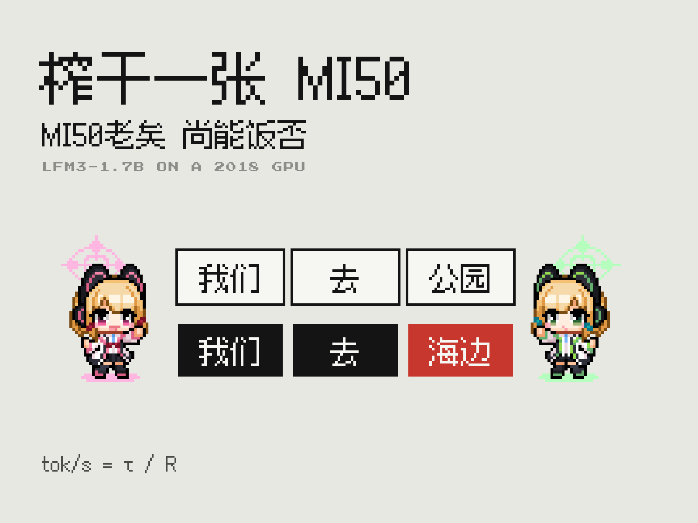
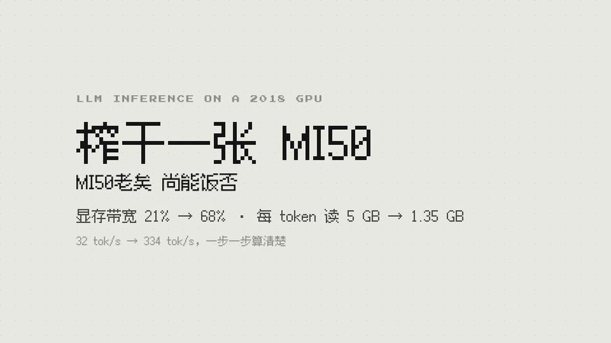
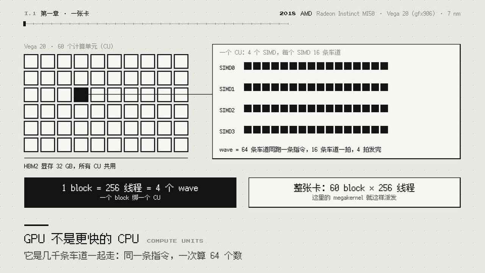
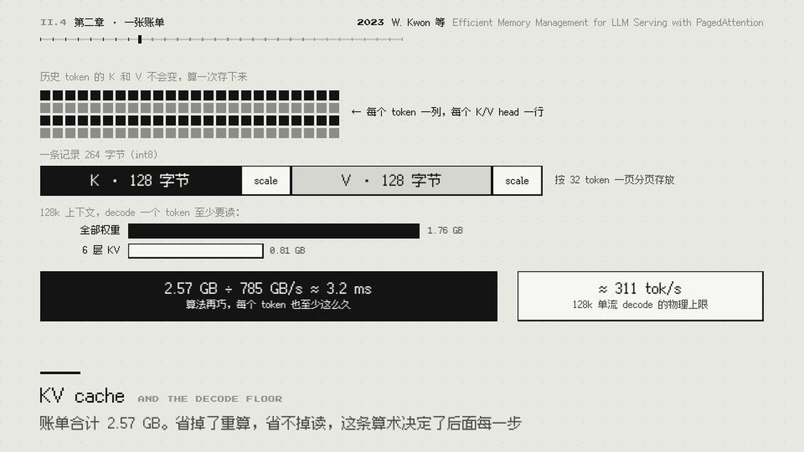
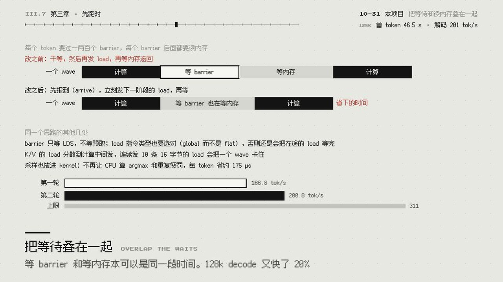
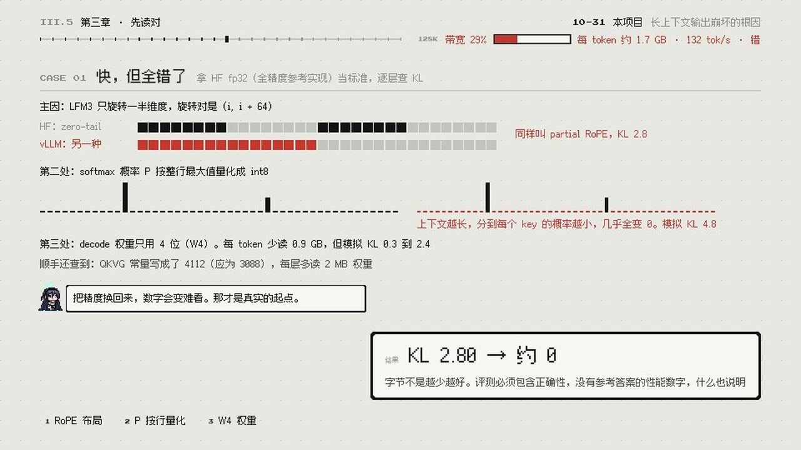
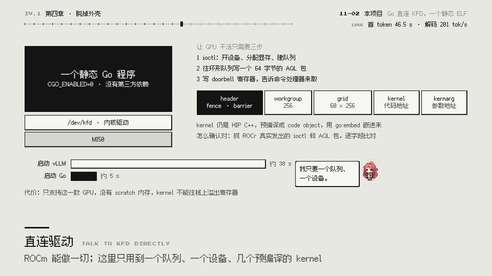
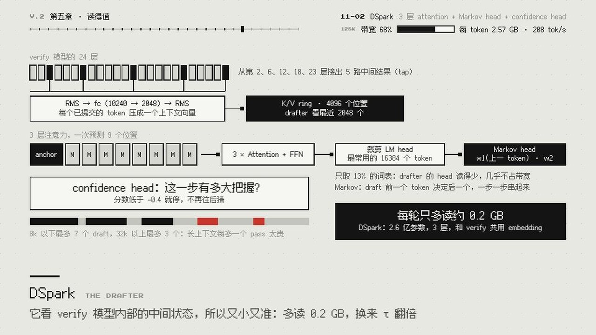
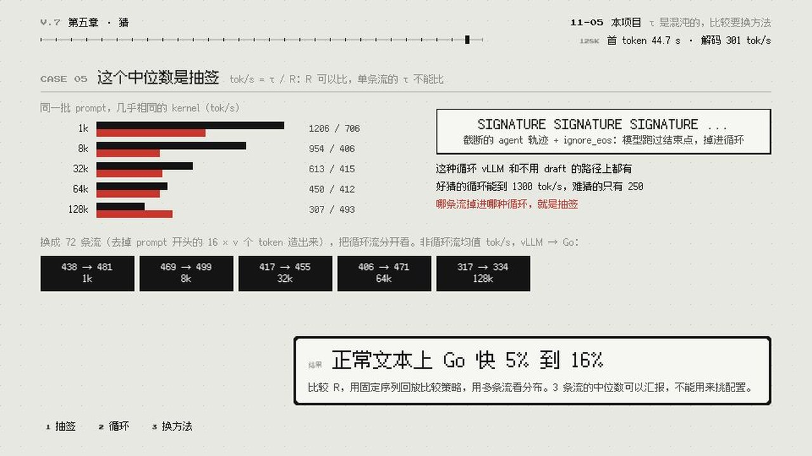

# 榨干一张 MI50 · MV

**MI50老矣 尚能饭否**

一部讲解 LLM 推理优化的 Remotion 动画短片。全片只有一条主线：**一张 2018 年的 AMD Radeon Instinct MI50 有 785 GB/s 的显存带宽，怎么才算用完。** 五章、三十多个场景，从这张卡的基本架构和 LLM 推理的基本概念讲起，再按真实的优化顺序一步步算账。目标观众是学过计算机组成和操作系统的本科生。

全片围绕一条式子：

```
tok/s = 785 GB/s × 利用率 U ÷ 每提交一个 token 读的字节
```

每一步优化都在动这条式子里的一项。128k 上下文，单流 decode：

| 阶段 | 每 token 读 | 带宽利用率 U | tok/s |
|---|---|---|---|
| 起点 | 约 5 GB | 21% | 32 |
| W4 megakernel（输出错误） | 约 1.7 GB | 29% | 132 |
| W8，修好精度 | 2.57 GB | 55% | 167 |
| 把等待叠在一起 | 2.57 GB | 66% | 201 |
| Go · 直连 KFD | 2.57 GB | 68% | 208 |
| DSpark | 1.35 GB | 58% | 334 |

推导见 [`docs/BANDWIDTH.md`](docs/BANDWIDTH.md)，完整的优化记录见 [`docs/OPTIMIZATION_REPORT.md`](docs/OPTIMIZATION_REPORT.md)。

1920×1080 / 60fps，时间轴驱动；一套代码同时出「渲染成片」和「网页实时版」，配乐由脚本按时间轴程序化生成。

这个分支（`lfm3-mi50`）沿用 `main` 分支《现代密码学 MV》的引擎、字体、人物和配乐生成器，内容全部重写。



画面是灰白黑「纸与墨」的极简像素风，语气是工程记录；概念场景标注**年份 · 作者 · 论文**，优化步骤标注**日期**。页眉有一条进度标尺和一块带宽表，显示当时的利用率、每 token 读的字节和解码速度。**所有数字都来自真实测量**，估算的地方写明是估算。

## 效果预览

| 片头 | GPU 架构 |
|---|---|
|  |  |

| KV cache 与带宽上限 | 把等待叠在一起 |
|---|---|
|  |  |

| 踩坑记录：快，但全错了 | 直连驱动 |
|---|---|
|  |  |

| DSpark drafter | 这个中位数是抽签 |
|---|---|
|  |  |

## 内容

| 章 | 主线上的位置 | 内容 |
|---|---|---|
| 序 | 这条式子 | 片头（`generate("hello")` 等了 238 秒，带宽只用了五分之一）· 总览 |
| I 一条路 | 785 GB/s | CU、SIMD、wave、block · 存储层级 · 怎么量带宽（理论 1024，实测 785，L2 曲线）· `v_dot4` 与 `v_dot2` · Roofline 与功耗墙 |
| II 一张账单 | GB / token | 生成循环、prefill 与 decode · 权重的账（1.76 GB）· Q/K/V、GQA、RoPE · KV cache 与 311 tok/s 的上限 · 每字节几次运算（decode 撞带宽，prefill 撞算力）· 量化与 KL |
| III 先读对 | 少读，但不能读错 | 21% 的起点 · megakernel · 支线：Flash attention、W8A8 GEMM · **案例：快，但全错了** · 2.57 GB 的正确基线 |
| IV 读得满 | U：55% → 68% | 把等待叠在一起 · 在途 load，让 GEMV 贴着上限读 · **案例：第 0 层的旧值** · 直连 KFD、AQL 队列 · L2 回写与 agent scope |
| V 读得值 | GB / token：2.57 → 1.35 | draft 与 verify，`tok/s = τ / R` · DSpark drafter · 一轮里内存的忙与闲 · 离屋顶多远 · 逐项账单 · **案例：int8 的价格** · **案例：这个中位数是抽签** · 越过 block 边界 |
| 尾 | 还剩 42% | 七天的账 · 和 vLLM 比 · 还没用上的 · 致谢 |

讲解顺序基本就是优化发生的顺序（「读得满」里的 GEMV 和驱动部分与 DSpark 的时间有交叠，按主线归到一起）。失败和错误也保留：第三章的崩坏、第五章的混沌，都是实际发生过的。

## 工程结构

```
src/
  Root.tsx Main.tsx       Composition（cast: ba / classic）
  timeline.ts             镜头表：五章的场景、节奏档位；自动计算真实时长与音效时刻
  cites.ts                每个场景的 {year, who, work}、各章里程碑、记分牌
  theme.ts                纸与墨的配色 token、像素字体、6px 网格、缓动与量化工具
  components/             Shot（转场 + 时间映射）· ui（页眉 / 旁白 / 进度标尺 / 记分牌）· Problem（案例页）
                          ActTitle（章标题）· pixel（像素面板 / 精灵 / 方块光标）· kit
  scenes/                 lib（绘图原语）· hw · llm · run · go · ds · ds2 · Intro · fin
web/                      网页实时版（Remotion Player，可切换两套人物）
audio/make_music.py       8-bit 配乐生成；audio/timeline.json 为导出的时间轴（可再生）
scripts/                  时间轴导出 · 静帧 / 拼图 · 批量渲染 · 符号字体生成 · 字形检查
public/                   渲染用静态资源（字体、人物精灵、配乐 mp3）
web-public/               网页版静态资源
assets/screenshots/       README 截图
```

节奏档位、转场、配色、字体约定都和 `main` 分支相同：A 核心 0.75× · B 标准 0.88× · C 利落 1.0× · 章标题 0.67× · 首尾 0.85×；每个场景最多 3 个关键时刻自动放慢；只用 `COL.*` 语义色，唯一强调色是表示错误的红；坐标对齐 6px 网格；全部像素字体。

## 人物

| 角色 | 人物（`cast: 'ba'`） |
|---|---|
| drafter（负责猜） | 才羽桃井 |
| verifier（负责验证） | 才羽绿 |
| 算账的人（Roofline、功耗） | 早濑优香 |
| 研究者（查根因、下结论） | 天童爱丽丝 |
| 工程师（驱动） | 花冈柚子 |

人物精灵取自 pixiv #95092393（"Game Development Department" 像素立绘），按原生分辨率裁切、去背景，嵌入在 `src/components/sprites_data.ts`。**该图为他人作品，公开发布前请取得作者授权并署名**；`cast: 'classic'` 的版本使用原版单色像素小人，不含该素材。

## 配乐

沿用 `audio/make_music.py`：Pachelbel《D 大调卡农》（公有领域）的 8-bit 编配。全片一条连续的卡农，段落之间只改变密度，各章升调，场景里的 cue 映射为芯片音效。

## 快速开始

```bash
npm install
npm run studio          # Remotion Studio 预览
npm run web:dev         # 网页实时版
```

配乐（需要 Python）：

```bash
python3 -m venv .venv && .venv/bin/pip install numpy scipy soundfile fonttools brotli pillow
npm run music           # 导出时间轴并生成 public/music.wav
npm run audio:mp3       # 转出 mp3（网页版用）
```

## 渲染

```bash
bash scripts/render_all.sh                    # 两个版本 → out/MI50_MV{,_classic}.mp4
npm run render                                # 仅游戏开发部人物版
bash scripts/sheet.sh name hw_chip:800 go_l2:600   # 按「镜头:场景帧」渲染静帧并拼图到 out/name.jpg
npx remotion still Cover assets/cover.png --image-format=png   # 封面（1600×1200，4:3）
```

渲染配置在 `remotion.config.ts`（h264 / crf 17 / yuv420p / jpeg 92，并发 8）。本地渲染前先 `npm run music` 生成 `public/music.wav`（母带不进仓库）。

## 不进仓库的内容

`node_modules/`、`.venv/`、`out/`（渲染输出）、`public/*.wav`（母带）。

## 许可

代码同 `main` 分支。Fusion Pixel 和 Press Start 2P 字体按 OFL 授权。人物素材见上文。
